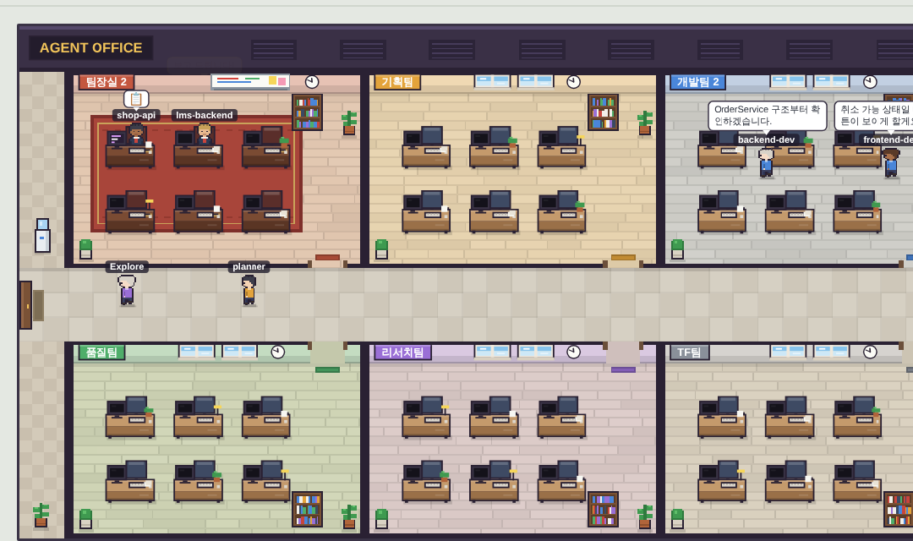
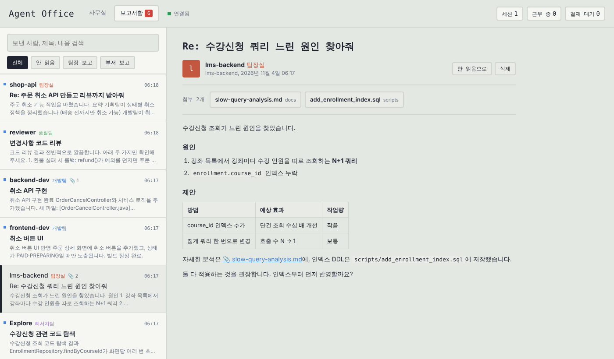

# Agent Office

Claude Code 에이전트를 부서별 픽셀 사무실로 보여주는 대시보드입니다. 메인 에이전트는 팀장실에, 서브에이전트는 `departments.json`에 정한 부서 자리에 출근해서 실제 작업(파일 읽기, 코드 수정, 명령 실행, 검색 등)에 맞춰 움직입니다.

Windows(PowerShell, cmd)를 기준으로 만들었고 macOS·Linux에서도 동작합니다. 외부 npm 패키지가 없어서 Node.js만 있으면 됩니다.



## 준비물

Node.js 18 이상이 필요합니다. PowerShell에서 `node -v`로 확인하세요.

## 설치와 실행

압축을 원하는 위치(예: `C:\tools\agent-office`)에 풀고, 그 폴더에서 아래 순서대로 실행합니다. 각 단계는 같은 이름의 `.bat` 파일을 더블클릭해도 됩니다.

```powershell
cd C:\tools\agent-office

# 1. Claude Code 훅 설치 (한 번만)
npm run install-hooks        # 또는 install-hooks.bat

# 2. 서버 실행
npm start                    # 또는 start.bat
```

브라우저에서 http://localhost:4000 을 열고, **열려 있던 Claude Code와 Claude 앱을 다시 시작**하면 끝입니다. 이후 Claude Code에 일을 시키면 팀장이 출근합니다.

폴더를 옮기면 훅 경로가 바뀌므로 `npm run install-hooks`를 다시 실행하세요.

## Claude Code 없이 미리 보기

서버를 켠 상태에서 다른 터미널을 열고 실행합니다. 두 개의 가상 프로젝트에서 기획팀, 개발팀, 품질팀, 리서치팀이 차례로 일하고 보고서를 제출하는 모습을 보여줍니다. 시뮬레이터가 만든 보고서는 보고서함에서 삭제하면 됩니다. 첨부 다운로드를 시험할 수 있도록 시뮬레이터는 임시 폴더(`%TEMP%\agent-office-demo`)에 데모 파일을 만듭니다.

```powershell
npm run simulate             # 한 번
npm run simulate -- --loop   # 계속 반복 (강의 시연용)
```

## 부서 구성 바꾸기

`departments.json`에서 부서와 소속 에이전트를 정합니다. `agents`에는 `.claude/agents/`에 정의한 서브에이전트 이름(파일의 `name`)을 적습니다. 대소문자는 구분하지 않습니다. 파일을 저장하면 서버를 껐다 켜지 않아도 1초 안에 반영됩니다.

```json
{
  "leadRoom": "팀장실",
  "defaultDept": "TF팀",
  "departments": [
    { "name": "기획팀", "color": "#e3a33b", "agents": ["planner", "architect", "Plan"] },
    { "name": "개발팀", "color": "#4a86d9", "agents": ["backend-dev", "frontend-dev", "general-purpose"] }
  ]
}
```

어느 부서에도 없는 에이전트는 `defaultDept`(기본값 TF팀)에 앉습니다. `Plan`, `Explore`, `general-purpose`는 Claude Code 기본 서브에이전트 이름입니다. 부서는 몇 개든 추가할 수 있고, 위·아래 두 줄로 자동 배치됩니다.

## 보고서함

서브에이전트가 업무를 마치고 팀장에게 돌려준 보고와, 팀장(메인 에이전트)의 최종 답변이 메일처럼 쌓입니다. 상단의 **보고서함** 탭(http://localhost:4000/#inbox)에서 볼 수 있고, 안 읽은 보고서 수가 탭에 표시됩니다. 보고서가 도착하면 사무실에서 팀장 머리 위에 📨가 잠깐 뜨고, 캐릭터를 클릭하면 그 직원의 최근 보고서가 열립니다.



보고서는 `reports/년월/` 폴더에 마크다운 파일로 저장되어 서버를 껐다 켜도 남아 있고, 메모장이나 VS Code로 직접 열어봐도 됩니다. 읽음 표시는 `reports/.read.json`에 저장됩니다. 보고서함에서 삭제하면 파일도 함께 지워집니다.

팀장의 짧은 대답("네, 알겠습니다" 같은)까지 쌓이지 않도록, 팀장 보고는 `leadMinLength`(기본 200자) 이상일 때만 저장합니다. 제목은 팀장 보고는 마지막 지시 내용, 부서 보고는 위임할 때의 업무 설명으로 붙습니다.

### 첨부파일

보고서 본문에 나온 파일(예: `[ddl_faq.sql](scripts/ddl_faq.sql)`, `` `docs/plan.md` ``, 그냥 적힌 `scripts/a.sql`)이 그 세션의 프로젝트 폴더 안에 실제로 있으면 첨부로 붙습니다. `ddl_faq.sql`처럼 폴더 없이 이름만 적혀 있어도, 그 세션에서 에이전트가 만들거나 고친 파일 중 같은 이름을 먼저 찾고, 없으면 프로젝트 폴더를 검색해서 찾습니다(`node_modules`, `build`, `.git` 등은 제외, 같은 이름이 여러 개면 가장 최근에 수정된 파일). 보고서를 열 때마다 첨부를 다시 확인하므로, 예전에 첨부가 안 붙었던 보고서도 열면 붙습니다. 보고서 상단의 첨부 버튼이나 본문의 📎 링크를 누르면 다운로드됩니다. 목록에서는 📎 숫자로 첨부 개수를 보여줍니다.

보고서 파일에는 첨부의 **경로만** 기록되고 내용은 저장되지 않습니다. 다운로드를 누르는 순간 서버가 디스크에서 읽어 내려주므로, 그 사이 파일이 수정됐다면 수정된 최신 내용이 받아지고, 지워졌거나 옮겨졌다면 그렇다고 알려줍니다. 보고서에 기록된 첨부 목록에 있고 프로젝트 폴더 안에 있는 파일만 받을 수 있습니다.

### 소스코드 제외

기본값으로 보고서 안의 코드 블록(```로 감싼 부분)은 `[코드 생략 · java · 24줄]`처럼 한 줄 표시로 바뀝니다. 잘라내는 작업은 훅 스크립트 안에서 일어나서, 코드 본문은 서버로 전송되지도 파일로 저장되지도 않습니다. 문장 중의 짧은 인라인 코드(`OrderService` 같은 이름)는 읽기 편하도록 남겨둡니다.

`departments.json`의 `reports`에서 바꿀 수 있습니다.

```json
"reports": {
  "enabled": true,       // false 면 보고서를 아예 수집하지 않음
  "stripCode": true,     // false 면 코드 블록도 그대로 저장
  "leadMinLength": 200   // 팀장 보고 최소 길이(글자 수)
}
```

(실제 파일에는 // 주석을 넣지 마세요. JSON 은 주석을 허용하지 않습니다.)

## 화면 읽는 법

말풍선과 모니터 화면이 지금 하는 일을 보여줍니다. 💭는 생각 중, 📖는 파일 읽기, 💻는 코드 작성·수정, ⚙️는 명령 실행, 🔍는 코드 검색, 🌐는 웹 조사, 📋는 서브에이전트에게 업무 지시, 📝는 할 일 정리, 🔧는 MCP 등 기타 도구 사용입니다. ✅는 작업 보고를 마친 상태, 💬는 다음 지시를 기다리는 상태, ☕는 한동안 활동이 없는 상태입니다. 빨간 **결재!** 말풍선은 권한 승인이 필요하다는 뜻이고, 이때 브라우저 탭 제목에도 결재 대기 수가 표시됩니다.

서브에이전트는 업무를 마치면 잠시 ✅를 띄운 뒤 퇴근(출입문으로 퇴장)하고, 세션이 끝나면 팀장도 퇴근합니다. 캐릭터에 마우스를 올리면 소속과 현재 작업을 볼 수 있습니다.

## 동작 원리

```
Claude Code (터미널 · Claude 앱 Code 탭)
   └─ ~/.claude/settings.json 의 훅
        └─ node hooks/agent-office-hook.js   (이벤트 JSON 을 로컬 서버로 POST)
             └─ server.js  (상태 계산, 127.0.0.1:4000)
                  └─ 브라우저  (Server-Sent Events 로 실시간 수신, canvas 로 사무실 렌더링)
```

훅 스크립트는 서버가 꺼져 있거나 오류가 나도 항상 성공(exit 0)으로 끝나므로 Claude Code 작업을 막지 않고, 표준출력에 아무것도 쓰지 않아 Claude 컨텍스트(토큰)에도 영향이 없습니다. 파일 내용이나 코드 diff는 보내지 않고 파일 경로, 명령어 요약, 검색어처럼 화면 표시에 필요한 값과 보고서 본문(코드 블록 제외)만 보냅니다. 서버는 `127.0.0.1`에서만 열려 같은 PC에서만 접속할 수 있습니다.

설치 스크립트는 기존 `settings.json`을 백업(`settings.json.agent-office-backup-날짜`)한 뒤 Agent Office 항목만 추가하며, 이미 있던 다른 훅은 그대로 둡니다.

## 문제 해결

**캐릭터가 나타나지 않을 때.** 먼저 서버를 켠 상태에서 `npm run simulate`가 화면에 보이는지 확인하세요. 시뮬레이터는 보이는데 실제 작업이 안 보이면 훅 쪽 문제입니다. Claude Code와 Claude 앱을 완전히 종료 후 다시 실행했는지, `%USERPROFILE%\.claude\settings.json`에 `agent-office-hook.js`가 들어 있는지 확인하세요. 프로젝트 폴더의 `.claude/settings.json`에서 훅을 끄는 설정(`disableAllHooks`)이 있으면 동작하지 않습니다.

**`node`를 찾을 수 없다는 오류.** Claude Code가 훅을 실행하는 환경에서 `node`가 PATH에 없는 경우입니다. `settings.json`의 훅 명령에서 `node`를 `"C:/Program Files/nodejs/node.exe"`처럼 전체 경로로 바꾸세요.

**포트 4000을 이미 쓰고 있을 때.** 사용자 환경변수 `AGENT_OFFICE_PORT`를 다른 값으로 설정하면 서버, 훅, 시뮬레이터가 모두 그 포트를 씁니다. 설정 후 터미널과 Claude Code를 다시 열어야 적용됩니다.

```powershell
setx AGENT_OFFICE_PORT 4100
```

**서브에이전트의 개별 작업이 팀장에게 표시될 때.** Claude Code 버전에 따라 서브에이전트 내부의 툴 이벤트에 `agent_id`가 포함되지 않을 수 있습니다. 이 경우 서브에이전트는 자리에서 업무 중으로만 표시되고, 세부 툴 동작은 팀장 쪽 로그에 쌓입니다.

## 제거

```powershell
npm run uninstall-hooks      # 또는 uninstall-hooks.bat
```

Agent Office 훅만 지우고 다른 설정은 남겨둡니다. 그다음 폴더를 삭제하면 됩니다.
